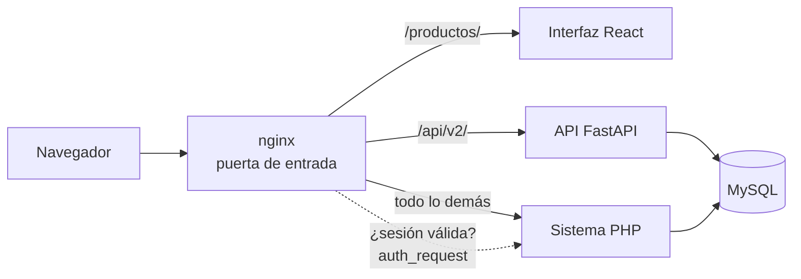
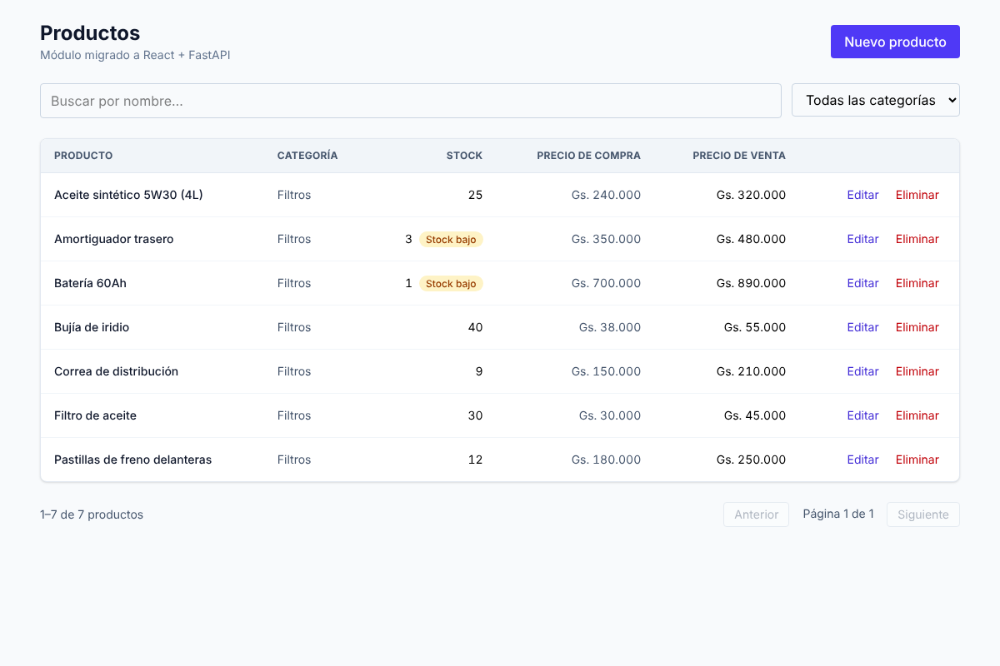
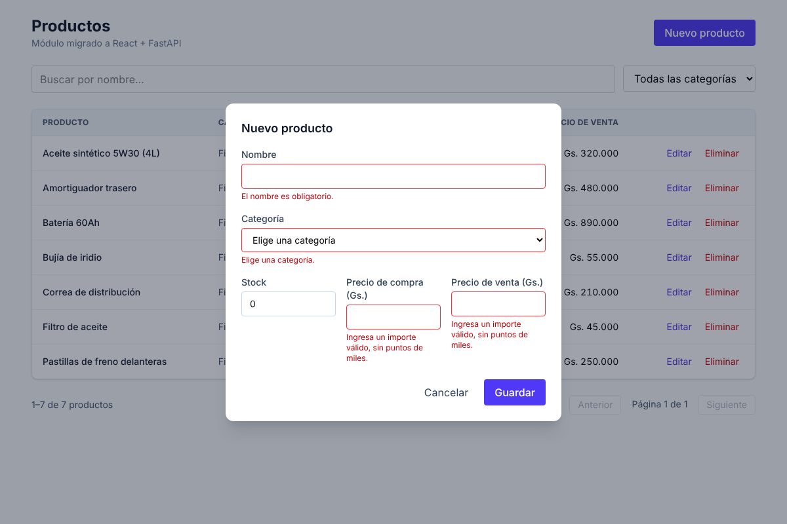

# Inventario PHP modernizado

[](https://github.com/RebeKra/inventario-php-modernizado-2026/actions/workflows/ci.yml)


Modernización de un sistema real de inventario y ventas escrito en **PHP plano + MySQL** en 2015:
[OSWA-INV](https://github.com/siamon123/warehouse-inventory-system), de Siamon Hasan (licencia MIT),
sin mantenimiento desde 2017.

El objetivo es mostrar cómo se trabaja con código legado que no escribiste: entenderlo, auditarlo,
protegerlo con pruebas, corregirlo y migrarlo de forma gradual a una arquitectura moderna con
**Python (FastAPI)** y **React + TypeScript**, sin detener el sistema.

**Resultado:** 16 problemas encontrados y documentados (4 críticos), 13 corregidos, el módulo de productos
migrado a Python + React sin detener el sistema, y 65 pruebas automáticas que corren en cada cambio.

## Hoja de ruta

| Fase | Descripción | Estado |
|---|---|---|
| 0 | Sistema original, ejecutable con Docker | ✅ |
| 1 | [Auditoría](AUDITORIA.md) y pruebas de caracterización con PHPUnit | ✅ |
| 2 | Corrección de seguridad y lógica de negocio; primeras capas en `src/` | ✅ |
| 3 | Migración del módulo de productos a FastAPI | ✅ |
| 4 | Nueva interfaz de productos en React + TypeScript | ✅ |
| 5 | Convivencia de ambos sistemas detrás de nginx | ✅ |
| 6 | Integración continua con GitHub Actions | ✅ |

## Hallazgos y correcciones

La [auditoría completa](AUDITORIA.md) detalla 16 hallazgos y su estado. Los más graves, ya corregidos:

| Antes | Después |
|---|---|
| 🔴 Contraseñas con **SHA-1 sin sal** | bcrypt, con **migración transparente** al iniciar sesión |
| 🔴 Cualquier usuario podía **cambiar la contraseña de otro** | Se usa siempre el usuario de la sesión |
| 🟠 **Sin CSRF**: un enlace GET borraba datos | Borrado solo por POST con token CSRF y confirmación |
| 🟠 El **navegador decidía el precio**: 3 baterías por Gs. 1 | El total se calcula en el servidor |
| 🟠 Se podía **vender más que el stock** | Descuento atómico (`WHERE quantity >= ?`) dentro de una transacción |

## Arquitectura

El código nuevo vive en `src/` y convive con el original: las páginas antiguas lo van
usando de a poco, sin reescribir todo de golpe.

```
src/
├── Database/   Conexion (consultas preparadas y transacciones)
├── Security/   Contrasenas (bcrypt + migración de SHA-1), Csrf
├── Auth/       Autenticacion + UsuarioRepositorio
└── Ventas/     RegistroDeVentas (reglas de negocio) + repositorios
```

- **Las reglas de negocio no dependen de la base de datos:** `RegistroDeVentas` recibe interfaces
  de repositorio, así que se prueba con versiones en memoria, sin MySQL.
- **Las páginas antiguas solo delegan:** por ejemplo, `add_sale.php` ahora llama a
  `RegistroDeVentas` en vez de armar el SQL a mano.
- **Cambios de esquema versionados:** `database/migraciones/` (por ejemplo, el stock pasa de texto a entero).

## API de productos (Python + FastAPI)

Primer módulo migrado con el patrón **strangler fig**: la API nueva y el sistema PHP
funcionan al mismo tiempo sobre la misma base de datos, y los módulos se van moviendo de a uno.

| Método | Ruta | Descripción |
|---|---|---|
| `GET` | `/api/v2/productos?buscar=&categoria_id=&pagina=&por_pagina=` | Listado con búsqueda y paginación |
| `GET` | `/api/v2/productos/{id}` | Detalle de un producto |
| `POST` | `/api/v2/productos` | Alta, con validación (409 si el nombre ya existe) |
| `PUT` | `/api/v2/productos/{id}` | Modificación |
| `DELETE` | `/api/v2/productos/{id}` | Baja (409 si tiene ventas, para no perder historial) |
| `GET` | `/api/v2/categorias` | Categorías |

Documentación interactiva (OpenAPI): http://localhost:8000/api/v2/docs

```
api/app/
├── main.py       Aplicación y manejo de errores
├── rutas.py      Endpoints HTTP
├── esquemas.py   Validación de entrada y salida (Pydantic)
├── servicio.py   Reglas de negocio, independientes de HTTP
└── modelos.py    Mapeo ORM (SQLAlchemy) sobre las tablas existentes
```

## Arquitectura: el sistema viejo y el nuevo, juntos



- **Una sola dirección para todo:** el usuario no nota qué parte es vieja y cuál es nueva.
- **Un solo inicio de sesión:** antes de llegar a la API o a la interfaz nueva, nginx le pregunta al
  sistema PHP si la sesión es válida (`auth_request` → `api_sesion.php`). No se duplican usuarios ni contraseñas.
- **CSRF también en la API:** el sistema PHP publica el token en la cookie `XSRF-TOKEN`; la interfaz React lo
  envía en la cabecera `X-CSRF-Token` y la verificación de sesión lo exige en cada modificación.
- **Las páginas viejas redirigen a las nuevas:** `product.php`, `add_product.php` y `edit_product.php` llevan a `/productos/`.
  Así se "estrangula" el módulo viejo sin romper enlaces ni favoritos.
- **Solo se publica lo necesario:** el volcado de la base y los archivos internos ya no se pueden descargar (H-14).

## Interfaz de productos (React + TypeScript)



Pantalla nueva del módulo de productos, construida con **React 19, TypeScript, Vite y Tailwind CSS**
sobre la API de FastAPI: búsqueda mientras se escribe, filtro por categoría, paginación,
alta y edición con validación, y aviso de stock bajo.

```
frontend/src/
├── PaginaProductos.tsx         Estado de la pantalla y coordinación
├── componentes/                Tabla, formulario y paginación
├── api/cliente.ts              Acceso tipado a la API y manejo de errores
├── tipos.ts                    Contratos de la API en TypeScript
└── utils/formato.ts            Formato de guaraníes sin perder precisión
```

- **Validación en dos niveles:** el formulario valida al instante y la API vuelve a validar todo;
  los errores de la API (por ejemplo, un nombre repetido) se muestran junto al campo correspondiente.
- **Accesible:** etiquetas asociadas a cada campo, mensajes de error anunciados y botones con nombre descriptivo.

<details>
<summary>Formulario con validación</summary>



</details>

## Decisiones técnicas

| Decisión | Por qué | Costo que se acepta |
|---|---|---|
| **Base de datos compartida** entre PHP y la API | Permite migrar módulo por módulo sin sincronizar datos ni detener el sistema | Ambos sistemas quedan acoplados al mismo esquema; se cambia con migraciones versionadas |
| **Mapear las tablas existentes** sin renombrarlas | El sistema PHP sigue funcionando sin cambios | Los nombres en inglés y con errores (`categorie_id`) quedan escondidos detrás del ORM |
| **Importes como texto decimal** (`"890000.00"`) en el JSON | Evita los errores de redondeo de los números con coma flotante | El cliente debe convertirlos para hacer cálculos |
| **Las mismas pruebas de datos** para PHP y Python | Garantiza que ambos sistemas funcionan sobre el mismo esquema | Un cambio en los datos de prueba afecta a las dos suites |
| **Formato de importes con texto y `BigInt`** en el frontend | Los guaraníes no tienen decimales y los importes grandes no pierden precisión | Hay que convertir explícitamente si se necesitan cálculos |
| **Autenticación en la puerta de entrada** (`auth_request`) | La sesión vive en PHP: nginx la verifica antes de llegar a la API, sin duplicar el login | Cada petición a la API hace una consulta extra a PHP; la API nunca debe exponerse sin el proxy |
| **Redirigir las páginas viejas** en lugar de borrarlas | Los enlaces y favoritos siguen funcionando y se puede volver atrás rápido | El código viejo de productos sigue en el repositorio hasta retirarlo |

## Cómo ejecutarlo

```bash
docker compose up --build
```

Todo entra por la puerta de entrada en http://localhost:8080:

- Sistema: http://localhost:8080 (usuario `admin`, contraseña `admin`)
- Productos (interfaz nueva): http://localhost:8080/productos/
- Documentación de la API: http://localhost:8080/api/v2/docs (requiere haber iniciado sesión)
- Interfaz nueva (modo desarrollo): `cd frontend && npm install && npm run dev` → http://localhost:5173/productos/

## Pruebas

Las pruebas de caracterización tratan al sistema como una caja negra: levantan el sitio con el
servidor embebido de PHP contra una base de datos de pruebas y hacen peticiones HTTP como un navegador.
Así protegen el comportamiento actual sin tener que modificar el código legado.

Requisitos: PHP 8.2+ con `mysqli` y un MySQL/MariaDB local con un usuario `app` / `app`
(configurable en `phpunit.xml.dist`).

```bash
composer install
composer test
```

```
OK (34 tests, 61 assertions)
```

- `tests/Unitarias`: reglas de negocio y autenticación, sin base de datos.
- `tests/Caracterizacion`: el sistema completo por HTTP, como un navegador.

API en Python (usa la misma base de pruebas y los mismos datos):

```bash
cd api
pip install -r requirements-dev.txt
pytest
```

```
16 passed
```

Interfaz en React (Vitest + Testing Library):

```bash
cd frontend
npm install
npm test
```

```
Tests  15 passed (15)
```

## Integración continua

En cada `push` y pull request, [GitHub Actions](.github/workflows/ci.yml) ejecuta en paralelo:

| Trabajo | Qué verifica |
|---|---|
| **PHP** | 34 pruebas con PHPUnit contra MySQL 8 (unitarias y de caracterización) |
| **Python** | 16 pruebas con pytest de la API contra MySQL 8 |
| **React** | Tipos de TypeScript, 15 pruebas con Vitest y compilación de producción |
| **Sistema completo** | Levanta todo con Docker Compose y ejecuta una [prueba de humo](scripts/prueba-humo.sh) a través de nginx: login, sesión compartida, CSRF, redirecciones y archivos bloqueados |

El último trabajo solo corre si los tres primeros pasan.

La prueba de humo demostró su valor en sus primeras ejecuciones: en Docker, la API y la interfaz nueva
quedaban abiertas sin iniciar sesión. La causa era una línea en blanco en un archivo de 2015 que solo
pasaba desapercibida con cierta configuración de PHP (H-16), y además la base caída respondía "éxito" (H-15).
Las pruebas de PHP ahora corren con la misma configuración que Docker para que no vuelva a pasar.

## Próximos pasos

- **Migrar el módulo de ventas** reutilizando `RegistroDeVentas`, y con él corregir H-12 (editar una venta no ajusta el stock).
- **Baja lógica de productos** (inactivo) en lugar de borrarlos, y quitar el `ON DELETE CASCADE` del esquema (H-13).
- **Retirar las páginas viejas de productos**, que hoy solo redirigen a la interfaz nueva.
- **Sacar el código de la carpeta pública** y dejar un único punto de entrada en PHP (H-14).
- **Consultas preparadas en todo el código heredado** que todavía arma SQL a mano (H-02).

## Créditos

Sistema original: **OSWA-INV** de Siamon Hasan, publicado bajo licencia MIT
(ver [LICENSE](LICENSE) y el [README original](README-original.md)).
